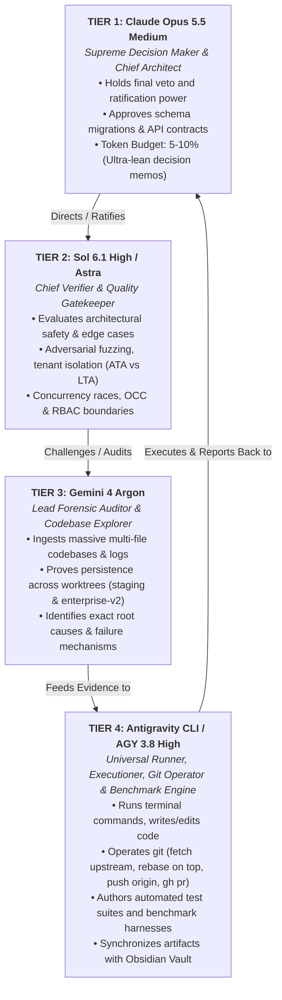
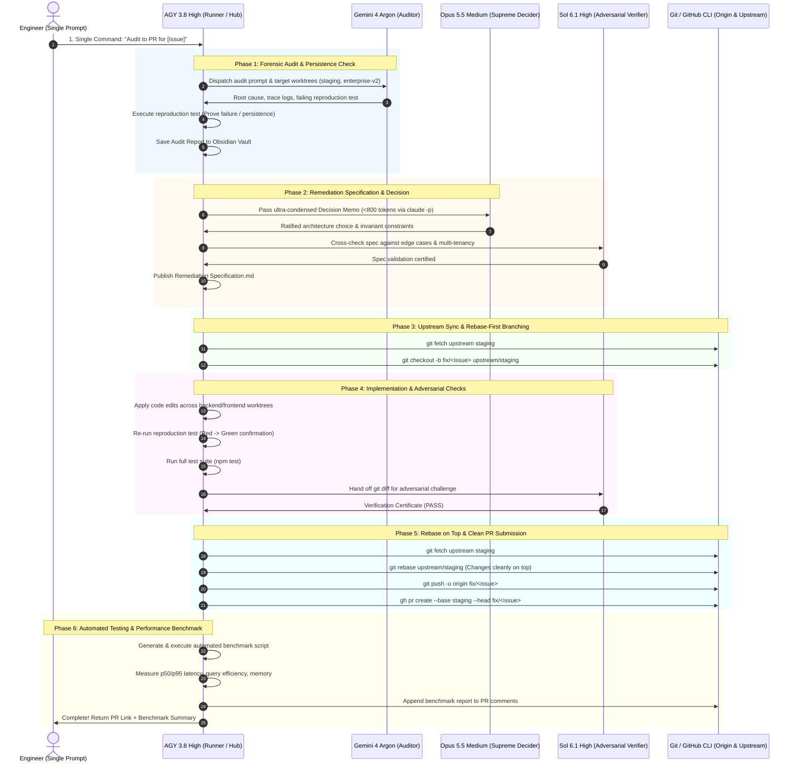

# Master Multi-Agent Autonomous Engineering Pipeline Specification
## End-to-End Delivery Protocol: Intake → Audit → Specs → Rebase → Verification → PR → Benchmark
**Document ID:** `SPEC-MASTER-AUTONOMOUS-PIPELINE-V1`  
**Date Ratified:** 2026-10-25  
**Governing Repositories & Worktrees:**
- **Backend Worktree:** `/home/deutz/Migration_Final-render/ata-lta-erp-final-render` (`staging`)
- **Frontend Worktree:** `/home/deutz/Migration_Final-render/ata-lta-erp-enterprise-v2` (`enterprise-v2`)
- **Upstream Remote (Source of Truth):** `https://github.com/jevvii/ata-lta-erp-final-render.git`
- **Origin Remote (Personal Fork):** `https://github.com/deutzgalila/ata-lta-erp-final-render.git`
- **Obsidian Vault Base:** `/home/deutz/Documents/Obsidian Vault/fix/`

---

## 1. Executive Summary & Objective

This specification establishes the standardized operational architecture for autonomous, single-prompt execution across complex bugfixes, refactors, and feature additions in the ATA & LTA Accounting Firm ERP ecosystem.

When an engineer issues an instruction (e.g. `/goal Fix issue X from audit to PR`), the system executes completely **hands-off** across six discrete phases:
1. **Forensic Audit & Persistence Verification** in active worktrees.
2. **Remediation Specification & Architecture Ratification** under strict agent hierarchy.
3. **Upstream Synchronization & Clean Rebase** (changes placed strictly on top of upstream).
4. **Implementation & Adversarial QA Verification** (flipping reproduction tests from red to green).
5. **Clean Fork Push & GitHub Pull Request Submission** (`gh pr create`).
6. **Automated Regression & Performance Benchmark Creation** (measuring latency, query efficiency, and tenant isolation).

---

## 2. Agent Decision Hierarchy & Division of Labor

To guarantee rigorous architectural integrity while strictly conserving limited token budgets, all participating AI models operate under a binding chain of command:



### Detailed Agent Responsibilities

| Hierarchy Rank | Model / Engine | Core Mandate | Constraints & Budget |
| :---: | :--- | :--- | :--- |
| **Rank 1 (Supreme)** | **Claude Opus 5.5 Medium** | **Supreme Decision Maker & Lead Architect**<br>• Selects optimal architectural pattern among alternatives.<br>• Defines non-negotiable invariants (OCC, multi-tenancy, RBAC).<br>• Provides final authorization for code commits and PR submission. | **Strictly Limited Quota:** Never reads raw terminal logs, node_modules, or 1000-line diffs. Only consumes high-density decision briefs (< 800 tokens). |
| **Rank 2 (Verifier)** | **Sol 6.1 High / Astra** | **Adversarial QA & Security Challenger**<br>• Interrogates specs for edge cases, race conditions, and boundary escapes.<br>• Validates whether an ATA-scoped user could accidentally mutate LTA data.<br>• Approves or rejects implementation before PR creation. | **Zero-Tolerance Gate:** Any failing edge case bounces the task back to Rank 4 for remediation. |
| **Rank 3 (Auditor)** | **Gemini 4 Argon** | **Forensic Researcher & Defect Auditor**<br>• Ingests backend (`staging`) and frontend (`enterprise-v2`) worktrees.<br>• Re-proves whether reported defect still persists in live staging.<br>• Pinpoints exact file paths, line ranges, and call graph failures. | **Massive Context Champion:** Consumes database schemas, commit histories, and multi-tenant middleware flows. |
| **Rank 4 (Runner)** | **Antigravity CLI / AGY 3.8 High** | **Universal Operator, Implementer & Hub**<br>• Central runner holding active bash, file editing, and git tools.<br>• Pulls from upstream, rebases changes cleanly on top, pushes to origin.<br>• Executes Jest, Supertest, and builds automated Benchmarks.<br>• Maintains persistent records in Obsidian Vault. | **Execution Engine:** Translates higher-tier directives into verified code diffs, commits, and PRs. |

---

## 3. Worktree & Repository Topology

The autonomous pipeline operates across two pre-existing linked Git worktrees and two remotes:

```
Working Environment Architecture
├── Remotes
│   ├── upstream -> https://github.com/jevvii/ata-lta-erp-final-render.git   (Canonical Source of Truth)
│   └── origin   -> https://github.com/deutzgalila/ata-lta-erp-final-render.git (Personal Push / PR Fork)
│
├── Linked Worktrees
│   ├── Backend Worktree:  /home/deutz/Migration_Final-render/ata-lta-erp-final-render     (branch: staging)
│   └── Frontend Worktree: /home/deutz/Migration_Final-render/ata-lta-erp-enterprise-v2   (branch: enterprise-v2)
│
└── Persistent Storage & Evidence
    ├── Project Audits:    docs/audits/<issue-slug-YYYY-MM-DD>/
    │   ├── Audit Report.md
    │   ├── fix/Remediation Specification.md
    │   ├── evidence/reproduction.test.js
    │   └── evidence/benchmark.test.js
    └── Obsidian Vault:    /home/deutz/Documents/Obsidian Vault/fix/
```

---

## 4. The 6-Phase Autonomous Execution Protocol



---

### Step-by-Step Operating Procedures

#### Phase 1: Forensic Audit & Persistence Verification
1. **Target Inspection:**
   - Probe `/home/deutz/Migration_Final-render/ata-lta-erp-final-render` (`staging`) for backend route/service logic.
   - Probe `/home/deutz/Migration_Final-render/ata-lta-erp-enterprise-v2` (`enterprise-v2`) for frontend UI/hook triggers.
   - Probe live staging database and Supabase storage to confirm whether defect records exist in staging.
2. **Empirical Reproduction Test:**
   - AGY 3.8 must author an automated, isolated reproduction test script (e.g., `evidence/reproduction.test.js`).
   - The test **must execute and FAIL** against unpatched code, proving exact bug persistence.
3. **Artifact Generation:**
   - Generate `Audit Report.md` containing: Summary, Affected Entities, Root Cause Mechanism, Call Stack Trace, and Blast Radius.
   - Immediately mirror to `/home/deutz/Documents/Obsidian Vault/fix/`.

#### Phase 2: Remediation Specification & Architectural Ratification
1. **Opus 5.5 Ingestion:**
   - AGY 3.8 formats a minimal decision brief:
     ```bash
     claude -p --dangerously-skip-permissions "
     ROLE: Supreme Decision Maker (Opus 5.5).
     DEFECT: <Summary of root cause from Argon>
     PROPOSED REMEDIATIONS:
     Option 1: <Approach A with trade-offs>
     Option 2: <Approach B with trade-offs>
     Select Option 1 or 2, define 3 invariants, and authorize implementation.
     "
     ```
2. **Sol 6.1 Sanity Gate:**
   - Sol 6.1 reviews Opus's approved path specifically searching for:
     - Cross-entity leakage (can ATA users view or mutate LTA records?).
     - Null or omitted payload crashes (`req.user.id`, `activeEntity`).
     - Optimistic Concurrency Control (OCC) version conflicts.
3. **Specification Publish:**
   - AGY 3.8 writes `Remediation Specification.md` detailing exact line edits for all modified files.

#### Phase 3: Upstream Sync & Rebase-First Branch Hygiene
To guarantee that the codebase never creates ugly merge bubble commits and is always production-mergeable:
1. Fetch latest upstream state:
   ```bash
   git fetch upstream staging
   git fetch upstream enterprise-v2
   ```
2. Create dedicated branch based directly off upstream:
   ```bash
   git checkout -b fix/<issue-slug> upstream/staging
   ```
3. If frontend changes are required:
   ```bash
   cd /home/deutz/Migration_Final-render/ata-lta-erp-enterprise-v2
   git fetch upstream enterprise-v2
   git checkout -b fix/<issue-slug>-frontend upstream/enterprise-v2
   ```

#### Phase 4: Implementation & Adversarial QA
1. **Code Modification:**
   - Apply precise, minimal edits to controllers, services, middlewares, and UI components.
   - Strictly preserve all unrelated comments, docstrings, and existing interfaces.
2. **Test Execution:**
   - Re-run reproduction test: **Must transition from FAIL (Exit 1) to PASS (Exit 0)**.
   - Run module unit tests: `cd backend && npm test`.
3. **Sol 6.1 Adversarial Fuzzing:**
   - Sol 6.1 generates tests attacking the patch:
     - Sending `X-Active-Entity: ALL` with single-entity tokens.
     - Sending concurrent mutations to verify row locking / OCC.
     - Sending malformed JSON payloads.

#### Phase 5: Rebase on Top & Clean PR Submission
1. **Rebase Hygiene:**
   - Immediately prior to pushing, fetch upstream again and rebase to guarantee local commits sit strictly on top:
     ```bash
     git fetch upstream staging
     git rebase upstream/staging
     ```
2. **Atomic Conventional Commit:**
   ```bash
   git add <modified-files>
   git commit -m "fix(<module>): <concise description of fix>

   - Root Cause: <brief root cause>
   - Remediation: <key changes applied>
   - Verification: <tests passed>
   - Tested-by: Antigravity Multi-Agent Pipeline"
   ```
3. **Push to Origin:**
   ```bash
   git push -u origin fix/<issue-slug>
   ```
4. **Create Pull Request via `gh` CLI:**
   ```bash
   gh pr create \
     --base staging \
     --head fix/<issue-slug> \
     --title "fix(<module>): <Title of Resolution>" \
     --body "$(cat <<'EOF'
   ## Summary of Changes
   ...
   ## Root Cause & Evidence
   ...
   ## Test & Verification Results
   - Reproduction test: PASSED (4/4)
   - Unit tests: PASSED
   - Multi-tenant boundary checks: PASSED
   EOF
   )"
   ```

#### Phase 6: Automated Testing & Performance Benchmark Creation
AGY 3.8 automatically creates a dedicated benchmark suite to guarantee zero performance regression:
1. **Benchmark Suite Authoring (`evidence/benchmark.js`):**
   - Simulates 50–100 sequential and concurrent requests against the remediated endpoint.
   - Collects:
     - **Latency Metrics:** `p50`, `p90`, `p95`, `p99`, Min, Max, and Mean response times (ms).
     - **Database Overhead:** SQL query count per transaction (verifying strict $O(1)$ lookup without N+1 loops).
     - **Memory & Throughput:** Node.js heap usage delta and req/sec capacity.
2. **Benchmark Reporting:**
   - Emits structured markdown benchmark table to `docs/audits/<issue>/evidence/BENCHMARK_REPORT.md`.
   - Appends the benchmark results directly as a comment on the open GitHub Pull Request:
     ```bash
     gh pr comment <pr-number> --body-file docs/audits/<issue>/evidence/BENCHMARK_REPORT.md
     ```
   - Syncs benchmark report to Obsidian Vault.

---

## 5. Automated Benchmark Standard

Every remediated defect must meet the following performance criteria during Stage 6 benchmarks:

| Metric | Target Benchmark SLA | Hard Failure Threshold |
| :--- | :---: | :---: |
| **API Latency (p50)** | $< 45\text{ ms}$ | $> 120\text{ ms}$ |
| **API Latency (p95)** | $< 95\text{ ms}$ | $> 250\text{ ms}$ |
| **Database Queries per Request** | $\le 2\text{ queries}$ (Lookup + Confirm) | $\ge 4\text{ queries}$ (Unindexed loop) |
| **Multi-Tenant Leak Rate** | $0.00\%$ ($0$ unauthorized records visible) | $> 0.00\%$ (Immediate Security Rejection) |
| **Memory Delta per 100 reqs** | $< 2.0\text{ MB}$ | $> 15.0\text{ MB}$ (Memory Leak) |

---

## 6. Single-Prompt Hands-Off Trigger Command

To trigger this entire pipeline autonomously from end to end, the user issues a single prompt:

```text
/goal Execute autonomous pipeline for: [Issue Description].
Follow MASTER_AUTONOMOUS_PIPELINE.md:
1. Audit & persistence check in backend (staging) and frontend (enterprise-v2).
2. Ratify remediation spec with Opus 5.5 and Sol 6.1.
3. Rebase on top of upstream/staging and implement fix.
4. Run adversarial checks and full tests.
5. Push origin and create clean PR.
6. Create AGY benchmark suite and report results to Obsidian Vault.
```

---

## 7. Compliance & Audit Verification Sign-Off

- **Lead Architect (Opus 5.5):** Ratification Authority
- **Chief Verifier (Sol 6.1):** Security & Invariant Gatekeeper
- **Forensic Auditor (Gemini 4 Argon):** Root Cause & Empirical Reproduction
- **Runner & Benchmark Engine (AGY 3.8):** Implementation, Git & Performance Testing
