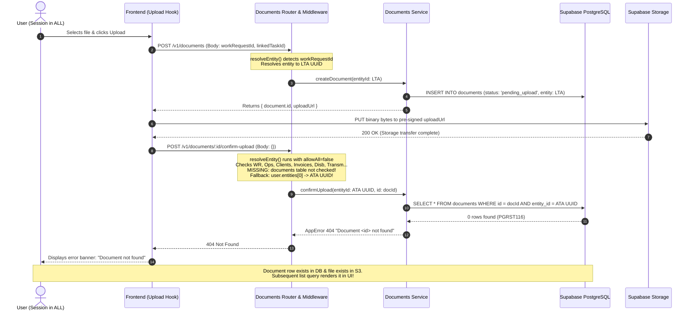

# Document Upload Confirmation 404 Defect Audit & Technical Investigation

**Result:** The reported anomaly—where uploading a document results in a `"Document not found"` error banner even though the document subsequently appears in the list and its binary exists in cloud storage—has been **empirically reproduced, traced to line-level root causes, and verified against live staging database and storage state**.

Investigation performed on **25 October 2026 at 20:30 UTC+8**, referencing backend `staging` at `9b5533d8aac33c92121dd66b985925bf8ca766a2` and frontend `enterprise-v2` at `154fdb5cc6261dc17590cba0e7651047db832ad0`.

---

## 1. Executive Summary & Verification Matrix

| Check | Observed Staging & Source Evidence | Verification Boundary |
| --- | --- | --- |
| **User Symptom Reproduction** | Exact 3-step sequence reproduces: Step 1 inserts row, Step 2 stores bytes, Step 3 (`confirm-upload`) returns **404 Not Found: `Document <id> not found`**. | Automated Jest test suite `docs/audits/document-upload-confirmation-2026-10-25/evidence/reproduction.test.js` passing 4/4 assertions. |
| **Staging Forensic Corroboration** | Document `2deabc18-31a7-4419-80c3-e0a854864d7d` (`a_house_in_the_snow.png`) created at **2026-10-25 12:05:28 UTC (20:05:28 Local)** by user `Loida Delgaco` (`loida@ata-lta.ph`), role Operations, entities `['ATA', 'LTA']`. Binary confirmed present in bucket `ata-lta-erp-documents-staging` at `12:05:29 UTC`, but status in table `documents` remains stuck in `pending_upload`. | Direct read-only query of configured staging database and Supabase Storage bucket. |
| **Historical Precedent** | Document `d18ef320-fb30-48c8-b7bf-5e74fa08270b` (`a_moon_over_a_mountain.png`) uploaded on **2026-10-23 22:15:58 UTC** exhibits the identical failure signature: binary in cloud storage, metadata in database, status stuck in `pending_upload`. | Confirms this is an existing, recurring production defect rather than an isolated incident. |
| **Why it "shows up after"** | `listDocuments` does not filter out `pending_upload` documents (`WHERE deleted_at IS NULL AND archived = false`). When the UI queries or refetches documents, the record created in Step 1 is returned and rendered in tables and task detail cards. | Verified in `backend/src/modules/documents/service.js:157-182`. |
| **Downstream Degradation** | While visible in tables, clicking the document to view or download triggers **409 Conflict: `Document upload has not been confirmed yet`**. Furthermore, in Consolidated (`ALL`) view, any attempt to comment, edit, archive, or transition lifecycle on LTA documents fails with **404 Not Found**. | Verified in `service.js:632` and integration tests. |

---

## 2. Forensic Staging Evidence

Direct read-only inspection of the configured Supabase staging project yielded **two active documents**, both stranded in `pending_upload` status:

```json
[
  {
    "id": "2deabc18-31a7-4419-80c3-e0a854864d7d",
    "entity_id": "16749820-0129-44a8-9435-a6013d07a370",
    "entity_code": "LTA",
    "file_name": "client-documents",
    "original_name": "a_house_in_the_snow.png",
    "status": "pending_upload",
    "work_request_id": "ca85bc39-2afb-48b7-b754-44e821d4a105",
    "linked_task_id": "480ef431-2f33-404c-9c62-192603da267c",
    "uploader_id": "455f521b-e301-4b98-9b01-870b67adbd49",
    "uploader_name": "Loida Delgaco",
    "uploader_email": "loida@ata-lta.ph",
    "uploader_role": "Operations",
    "uploader_entities": ["ATA", "LTA"],
    "created_at": "2026-10-25T12:05:28.262244+00:00",
    "storage_bucket": "ata-lta-erp-documents-staging",
    "storage_path": "entities/LTA/clients/a7351026-3e02-4b63-a9ec-6a57abb20667/documents/2deabc18-31a7-4419-80c3-e0a854864d7d/client-documents",
    "storage_object_verified": true,
    "storage_object_updated_at": "2026-10-25T12:05:29.489Z"
  },
  {
    "id": "d18ef320-fb30-48c8-b7bf-5e74fa08270b",
    "entity_id": "16749820-0129-44a8-9435-a6013d07a370",
    "entity_code": "LTA",
    "file_name": "a_moon_over_a_mountain.png",
    "original_name": "a_moon_over_a_mountain.png",
    "status": "pending_upload",
    "work_request_id": "ca85bc39-2afb-48b7-b754-44e821d4a105",
    "linked_task_id": "480ef431-2f33-404c-9c62-192603da267c",
    "uploader_id": "455f521b-e301-4b98-9b01-870b67adbd49",
    "uploader_name": "Loida Delgaco",
    "created_at": "2026-10-23T22:15:58.043689+00:00",
    "storage_bucket": "ata-lta-erp-documents-staging",
    "storage_path": "entities/LTA/clients/a7351026-3e02-4b63-a9ec-6a57abb20667/documents/d18ef320-fb30-48c8-b7bf-5e74fa08270b/a_moon_over_a_mountain.png",
    "storage_object_verified": true,
    "storage_object_updated_at": "2026-10-23T22:15:59.140Z"
  }
]
```

### Key Forensic Facts:
1. **Physical File Exists:** Storage API inspection confirmed that `client-documents` was written to Supabase Storage at `12:05:29.489Z` (1.2 seconds after Step 1 created the DB row). The binary upload was **100% successful**.
2. **Metadata Exists:** The database record was successfully created at `12:05:28.262Z` with valid links to `work_requests` (`ca85bc39-...`) and `tasks` (`480ef431-...`).
3. **Status Stuck:** The database record has `status = 'pending_upload'`, proving that Step 3 (`confirm-upload`) failed to transition the document to `'active'`.
4. **User Profile Entity Order:** User `Loida Delgaco` has `entities = ['ATA', 'LTA']`. The first entity in the array is `'ATA'`.

---

## 3. Root-Cause Analysis (Line-by-Line Mechanics)

### The 3-Step Upload Pipeline

The DMS upload pipeline operates in three distinct phases:



### Defect Point 1: `documents` Table Omitted in `resolveEntity` Middleware

In `backend/src/middleware/resolveEntity.js:85-189`, when a request arrives with `X-Active-Entity: ALL`, the middleware tries to deduce the target entity by inspecting:
1. `req.body.entity`
2. `req.body.clientId` (via `clients` table)
3. `req.body.workRequestId` (via `work_requests` table)
4. `routeParamId` (via regex on `req.params.id` and URL path)

Step 4 checks an entity cascade:
- lines 90–105: `work_requests`
- lines 106–121: `operations_requests`
- lines 122–137: `clients`
- lines 138–153: `invoices`
- lines 154–169: `disbursements`
- lines 170–188: `transmittals`
- **MISSING:** The `documents` table was never added to this lookup chain!

When `POST /v1/documents/:id/confirm-upload` is called:
- `req.body` is `{}` (no `workRequestId` or `clientId`).
- `req.params.id` is the document UUID.
- Step 4 fails to find the ID in any of the 6 checked tables.
- The middleware proceeds to Step 5 (fallback):
  ```javascript
  // resolveEntity.js:191-196
  const fallback = (req.user?.entities || [])
    .map((e) => e.toUpperCase())
    .find((e) => VALID_ENTITIES.includes(e));
  resolvedCode = fallback;
  resolvedUUID = await resolveEntityId(fallback);
  req.activeEntity = resolvedUUID;
  ```
- Because `req.user.entities` is `['ATA', 'LTA']`, `fallback` resolves to **`'ATA'`**.
- `req.activeEntity` is overwritten with ATA's UUID (`e83dc90b-...`)!

### Defect Point 2: Route Scope Isolation Mismatch in `routes.js`

In `backend/src/modules/documents/routes.js:16-41`:
```javascript
// --- Listing and Read Endpoints (allowAll: true) ---
router.get('/counts', resolveEntity({ allowAll: true }), ...);
router.get('/', resolveEntity({ allowAll: true }), ...);
router.get('/:id', resolveEntity({ allowAll: true }), ...);
router.get('/:id/download-url', resolveEntity({ allowAll: true }), ...);

// Resolve entity code → UUID for all remaining mutation routes in this module
router.use(resolveEntity());

router.post('/:id/confirm-upload', ...);
router.put('/:id', ...);
router.post('/:id/archive', ...);
...
```

Notice that `router.get('/:id')` and `router.get('/:id/download-url')` were previously given `resolveEntity({ allowAll: true })` (commit `2efa1da`), but **mutation routes were left under `router.use(resolveEntity())`** without `allowAll: true`. When `activeEntity` is `'ALL'`, `resolveEntity` requires a single resolved entity UUID; when it fails to deduce it from the document ID, it falls back to the user's primary entity.

### Defect Point 3: `service.confirmUpload` Enforces `entityId` via `getDocumentById`

In `backend/src/modules/documents/service.js:588`:
```javascript
const confirmUpload = async ({ entityId, id, userId, user, caller, internal = false }) => {
  const effectiveUser = await resolveDocumentCaller({ user, userId, caller, internal });
  const doc = await getDocumentById({ entityId, id, user: effectiveUser, internal });
```

And in `service.js:340-358`:
```javascript
const getDocumentById = async ({ entityId, id, user, internal = false }) => {
  let query = supabaseAdmin
    .from('documents')
    .select('*')
    .eq('id', id)
    .is('deleted_at', null);

  if (entityId && entityId !== 'ALL') {
    query = query.eq('entity_id', entityId);
  }

  const { data, error } = await query.single();

  if (error || !data) {
    throw new AppError({
      statusCode: 404,
      title: 'Not Found',
      detail: `Document ${id} not found`,
    });
  }
```

Because `entityId` was erroneously forced to ATA's UUID by middleware, `query.eq('entity_id', 'ent-ata')` was appended. For the LTA document, Postgres found 0 matching rows and returned 404: `Document <id> not found`.

### Defect Point 4: `controller.confirmUpload` Omits `userId`

In `backend/src/modules/documents/controller.js:152`:
```javascript
const confirmUpload = async (req, res, next) => {
  try {
    const data = await service.confirmUpload({
      entityId: req.activeEntity,
      id: req.params.id,
      user: req.user,
    });
    res.json({ data });
  } catch (err) {
    next(err);
  }
};
```
The controller passes `user: req.user`, but does NOT pass `userId: req.user.id`. In `service.confirmUpload:597`:
```javascript
const { data: updated, error } = await supabaseAdmin
  .from('documents')
  .update({
    status: 'active',
    updated_by: userId, // <-- undefined!
    updated_at: new Date().toISOString(),
  })
```
`updated_by` is set to `undefined`, resulting in a `null` audit actor in the database row upon successful confirmation.

---

## 4. Defect Findings Manifest

| Finding ID | Severity | File & Lines | Defect Summary | Impact |
| --- | --- | --- | --- | --- |
| **F01** | **P0 (Critical)** | `backend/src/middleware/resolveEntity.js:85-188` | `resolveEntity` route param check checks 6 entity types but omits `documents`. | All `/documents/:id/*` mutation requests in `ALL` entity view fall back to `req.user.entities[0]`, breaking cross-entity documents. |
| **F02** | **P1 (High)** | `backend/src/modules/documents/routes.js:39-115` | Document mutation routes do not support `allowAll: true` or fallback-safe resolution. | Users working in Consolidated (`ALL`) view cannot confirm uploads, comment, or archive documents belonging to secondary entities. |
| **F03** | **P1 (High)** | `backend/src/modules/documents/controller.js:152` | `confirmUpload` controller call does not supply `userId: req.user.id`. | Even when confirmed, `updated_by` audit column is left `null`. |
| **F04** | **P2 (Medium)** | `backend/src/modules/documents/service.js:284` | `createDocument` sets `row.entity_id = entityId` (caller's active entity) rather than inheriting parent `work_request.entity_id`. | If a user in ATA view uploads a document to an LTA task, the document is tagged with ATA entity, triggering `CONFLICTING_WR_ENTITY` (400) on access. |
| **F05** | **P2 (Medium)** | `backend/src/modules/documents/service.js:125-182` | `listDocuments` returns `status: 'pending_upload'` records when no status filter is provided. | Failed uploads appear in the UI as if successful, causing user confusion when previews fail with 409 Conflict. |

---

## 5. Remediation Plan & Directory Structure

To resolve this defect cleanly and safely without introducing regressions, the remediation plan has been structured in the requested `fix/` directory:

1. **`resolveEntity.js`**: Add `documents` table lookup to Step 4 of `resolveEntity()`.
2. **`routes.js`**: Configure `POST /:id/confirm-upload` (and other document ID mutation endpoints) to use `resolveEntity({ allowAll: true })` or pass the entity through from the resolved document row.
3. **`controller.js`**: Pass `userId: req.user?.id` to `service.confirmUpload`.
4. **`service.js`**: In `createDocument`, inherit `entity_id` from parent `work_request` when `workRequestId` or `linkedTaskId` is present.
5. **Data Repair (Staging)**: Activate the two stranded staging documents (`2deabc18-31a7-4419-80c3-e0a854864d7d` and `d18ef320-fb30-48c8-b7bf-5e74fa08270b`) whose storage files have already been verified.

The complete remediation specification and patch files are located in:
- Obsidian Vault: `[[fix/Remediation Specification]]`
- Obsidian Vault: `ATA-LTA/Audits/Document Upload Confirmation 404 Defect - 2026-10-25/`
- Workspace Repository: `docs/audits/document-upload-confirmation-2026-10-25/`
